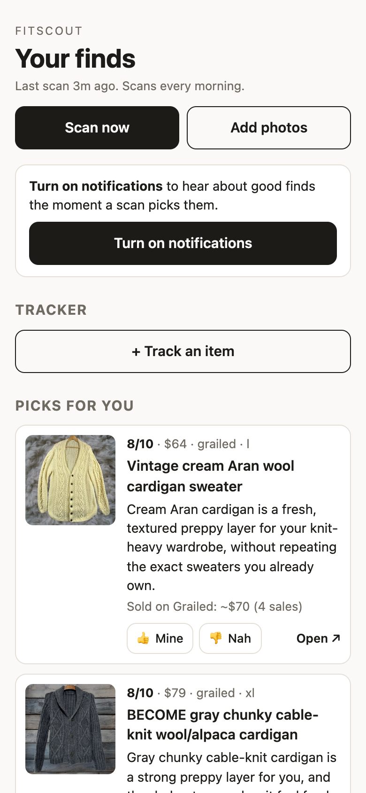
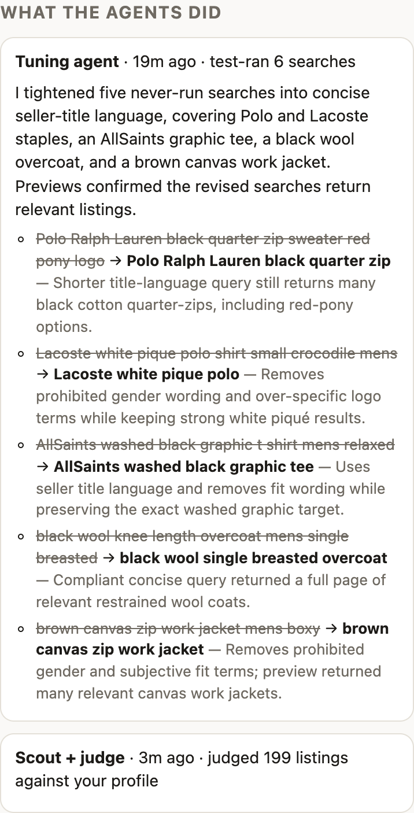
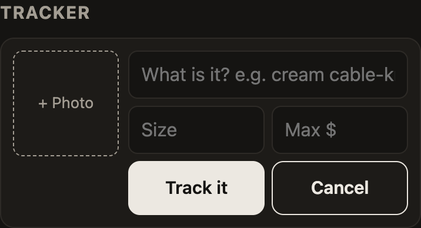

# fitscout

An agent-heavy clothing scout. It learns my taste from photos of clothes I wear and like, rewrites its own searches every morning based on what worked and what I rated, scans resale sites, judges every listing by its photos, and sends the best finds to an app on my phone. I step in where judgment about me, or money, is involved.

<p>
  
  
</p>

## What the agents handle, and where I step in

| Agents | Me |
| --- | --- |
| **Photo agent:** reads each photo I upload, separates every person's outfit, and catalogs the garments (fit, fabric, era, brand when a logo or tag shows). | Pick the photos. In group shots, confirm which person is me when my phone's face match misses. |
| **Profile agent:** turns the garments into a style brief, six style pillars, an avoid list, and resale searches aimed at *new* pieces in my lane (a Ralph quarter-zip in a new color or knit, an adjacent piece), never copies of what I already own. | Add what photos can't show: sizes ("L/XL", pants worn baggy), budget, brands I wear. Course-correct it when the picks drift (below). |
| **Tuning agent** (every morning, before the scan): reads how each search did and my 👍/👎, test-runs candidate searches on Grailed, then rewrites, adds, or drops searches, with a reason for each change. | Nothing, unless I disagree. Every change is logged in the app. |
| **Scout + judge:** runs the searches, has the AI score each listing against my profile from its photos (size, flaws, mislabeled brands, and whether it's just a copy of something I own), compares the price with what similar items actually sold for, and notifies me about the best. | Tap 👍/👎. That's the training signal the judge and the tuning agent learn from. |
| **Tracker:** from a photo and/or a description of something I want, writes a precise description and searches, then judges each listing by comparing its photos with mine, and searches right away. | Add the item: snap or screenshot it, type what it is. |
| **Meta Muse** (via the MCP connector): watches Facebook Marketplace and browses other sites as me, sending candidates to the same judge. | Approve anything that spends money or talks to a person. The agents can draft a message to a seller; nothing can send it, make an offer, or buy. |



## How it works

```
 phone photos ──► photo agent (per-person outfits; my face matched on my phone)
                    └► profile agent ──► style brief, pillars, avoid list, 40 searches
 every morning:
   tuning agent ──► reads per-search stats + my 👍/👎, test-runs searches on Grailed, rewrites the list
   scout + judge ──► Grailed (+ eBay API) ──► AI judge: quick look at 2 photos ──► 7+? close look at all photos + Grailed sold prices
                                                                                     └► best finds ──► push to the home-screen app
 Muse (MCP connector): Marketplace watch, browsing ──► judge_listings / price_check / hunts / tune_searches
 my 👍/👎 ──► every later judgment and the next morning's tuning
```

## First night, real numbers

- **Photos:** 50 photos produced 150 garments. My face was matched on-device in 48 of the 50, including 27 group shots.
- **Tuning agent:** test-ran 6 searches and rewrote 5 overly specific ones into the words sellers actually use in titles, in 21 seconds for $0.16.
- **First scan:** pulled 131 Grailed listings and judged 130 in 103 seconds. It flagged 22 as worth showing and sent the best 6 as notifications.
- **Size check:** XXL and M versions of a sweater were marked as the wrong size for "L/XL".
- **Course correction:** the top pick was a $43 black Polo quarter-zip at 9.5/10, which is basically one I already own. I said I want new things inspired by my style, not copies. Now the judge and the tuning agent see the 133 garments in my photos and cap near-copies at 5/10, and the searches were rebuilt toward variations ("Polo Ralph Lauren cable cardigan", "Lacoste navy long sleeve polo", "suede bomber jacket taupe").
- **After the correction:** the next scan judged 199 listings in 156 seconds. The top picks were a vintage cream Aran wool cardigan ($64), a gray chunky cable-knit cardigan, a charcoal merino mock-neck quarter-zip, and Ralph Lauren striped oxfords.
- **Cost:** the whole first night, including building and testing, used $3.12 of OpenAI. A hard daily cap ($2 by default, $5 here) stops the AI calls if it's reached.

## Building it was agent-heavy too

I built and debugged it in one evening with Claude Code, from my phone. I tested on my iPhone and described what I saw; the agent read the Vercel logs, reproduced issues in a headless Chrome, and shipped fixes. The logs showed that uploads past the first 20 never left my phone (memory pressure in iPhone Safari stalling the face matcher), and that most profile searches returned zero results on Grailed. The agent can't see my phone, so on-device testing is mine.

## Privacy and limits I chose

- **Face matching stays on the phone.** The cloud model only sees a copy of the photo with a green box around me, so it never has to recognize anyone. My reference selfies are never uploaded.
- **No bot-evasion scraping.** Grailed is searched through the public search key its own website uses, and eBay through its official API. Depop sits behind bot protection and Poshmark's robots.txt disallows search, so both are left to Muse, browsing as me.
- **No tool that sends, offers, or buys.**

## Setup

1. **Deploy** to Vercel, add Upstash Redis and Vercel Blob, and set `OPENAI_API_KEY`, `FITSCOUT_TOKEN`, and `VAPID_PUBLIC_KEY` / `VAPID_PRIVATE_KEY` (`npx web-push generate-vapid-keys`). Optional: `EBAY_CLIENT_ID` / `EBAY_CLIENT_SECRET` for eBay, and `NTFY_TOPIC` for ntfy alerts as well.
2. **Photos:** `npm run upload:link` prints a QR code for the phone upload page. Upload photos, fill in your details, and tap "Build my profile".
3. **App:** open `/a/<your key>` in Safari, tap Share, then Add to Home Screen. Open it from the Home Screen and turn on notifications.
4. **Muse:** follow `muse/SETUP.md`.
5. **Schedule:** `vercel.json` runs the morning job (tune, then scan) daily at 13:00 UTC. "Scan now" in the app runs it on demand, at most once an hour.

Locally, without the phone: put photos in `inspo/`, then run `npm run taste:ingest`, `npm run taste:build`, and `npm run taste:push`.

## Sources

| Source | How | Status |
| --- | --- | --- |
| Grailed | Public search key (the one grailed.com ships to every browser) | Live; also powers sold-price comps |
| eBay | Official Browse API | Needs a free eBay developer keyset |
| Facebook Marketplace | Muse's watch, sent to `judge_listings` | Needs the Muse connector |
| Depop, Poshmark | Muse browsing as me | Not searched by the server (bot protection; robots.txt) |

## Layout

- `lib/detect.ts`: per-person garment detection, adapted from [tandpfun/wardrobe](https://github.com/tandpfun/wardrobe)'s importer
- `lib/taste.ts`: the profile agent, and the brief every prompt uses
- `lib/tune.ts`: the tuning agent (tools: search stats, ratings, live Grailed preview, edit searches/avoid list)
- `lib/openai.ts`: structured calls, the tool-using agent loop, and the daily spend cap
- `lib/judge.ts`, `lib/pipeline.ts`: the two-stage judge (with the near-copy rule and photo comparison for tracked items), sold comps, and notification rules
- `lib/sweep.ts`: the morning job (tune, then scan)
- `lib/tools.ts`: the MCP tools Muse sees
- `app/a/[key]`: the home-screen app (tracker, finds feed, 👍/👎, agent log, Web Push)
- `lib/hunts.ts`: tracker items from words or a photo
- `app/upload`, `app/upload/face.ts`: the phone upload page and on-device face matching

`npm test` runs the unit tests.
